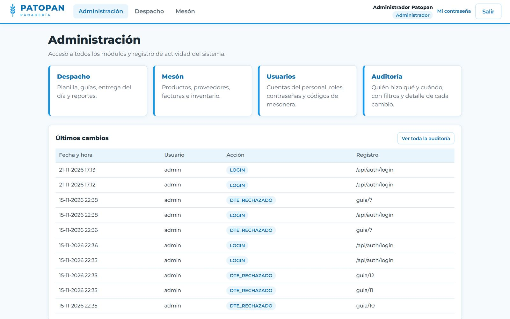
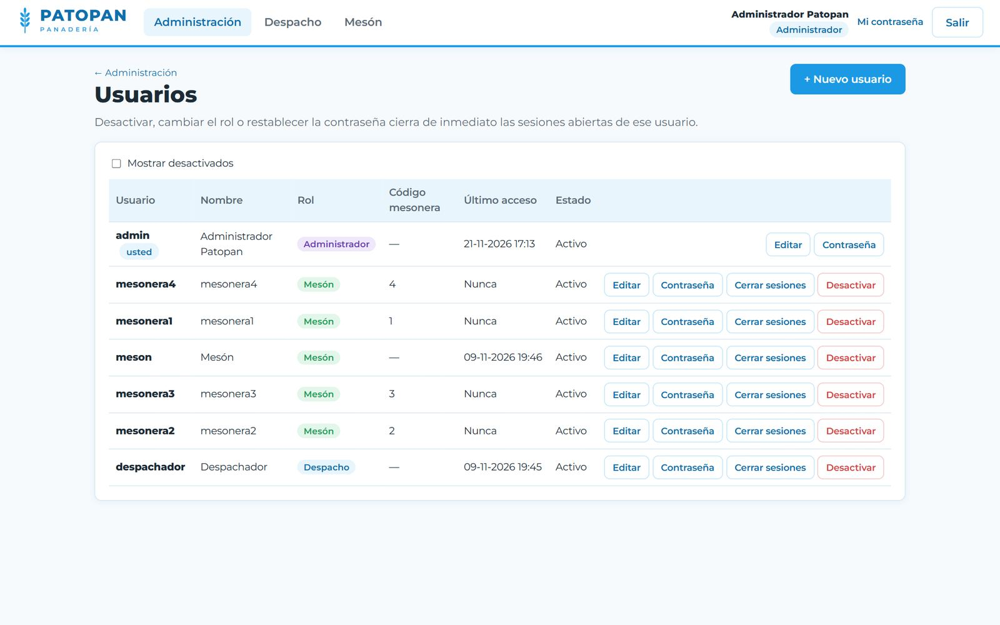
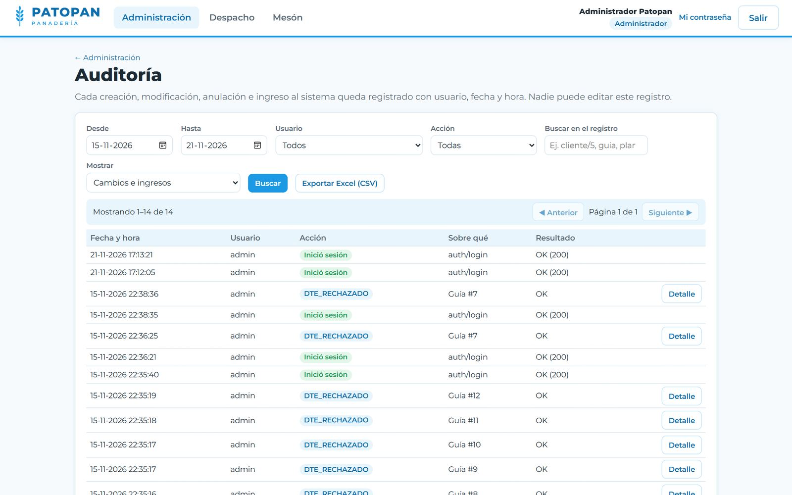

# Manual de usuario · Administración

Para el **dueño o administrador** (usuario con rol *Administrador*). Tiene acceso a todo el sistema: Despacho, Mesón y Administración (usuarios y auditoría).

## 1. Ingresar

Igual que los demás roles. El administrador ve en el menú superior **Administración**, **Despacho** y **Mesón**; las secciones de Despacho y Mesón se usan como se explica en sus manuales.

## 2. Usuarios

1. **+ Nuevo usuario**: usuario, nombre, rol (**Administrador**, **Despacho** o **Mesón**) y contraseña inicial.
2. A cada mesonera se le asigna su **código de mesonera** (el número que imprime la balanza en el ticket: V1, V2…). Con ese código el reporte de ventas sabe quién vendió.
3. Acciones por usuario:
   - **Editar**: nombre, rol o código.
   - **Contraseña**: restablece la contraseña.
   - **Cerrar sesiones**: cierra de inmediato las sesiones abiertas de ese usuario.
   - **Desactivar**: el usuario ya no puede ingresar, pero su historia se conserva.

Desactivar, cambiar el rol o restablecer la contraseña cierra de inmediato las sesiones abiertas de ese usuario.

## 3. Auditoría (registro de acciones)

Cada creación, modificación, anulación e ingreso al sistema queda registrado con **usuario, fecha y hora, acción, sobre qué y resultado**: guías emitidas e impresas, anulaciones, envíos al SII (aceptados o rechazados), ajustes de stock, ingresos e intentos fallidos.

- Filtre por fechas, usuario y acción, o escriba en **Buscar en el registro** (por ejemplo, `guia`) para responder "¿quién hizo esto y cuándo?".
- **Detalle** muestra qué cambió exactamente. **Exportar Excel (CSV)** descarga el resultado.
- Nadie puede editar ni borrar este registro.

## 4. Tareas del administrador

| Cuándo | Tarea |
|---|---|
| Al partir | Cambiar las contraseñas iniciales y crear un usuario por persona (con código para las mesoneras). |
| Al partir | Completar RUT, dirección y comuna de los clientes, y RUT y patente de los repartidores: el SII los exige en cada guía. |
| Cada semana | Revisar el reporte de ventas por mesonera (uso de "Misc.") y los conteos con diferencia. |
| Cada mes | Revisar que las facturas del mes se emitan antes del día 10. |
| Antes del 31-01-2027 | Informar al SII el modelo operacional de transporte (Res. SII 144/2026, resolutivo 16°). |
| Si alguien deja la panadería | **Desactivar** su usuario. |
