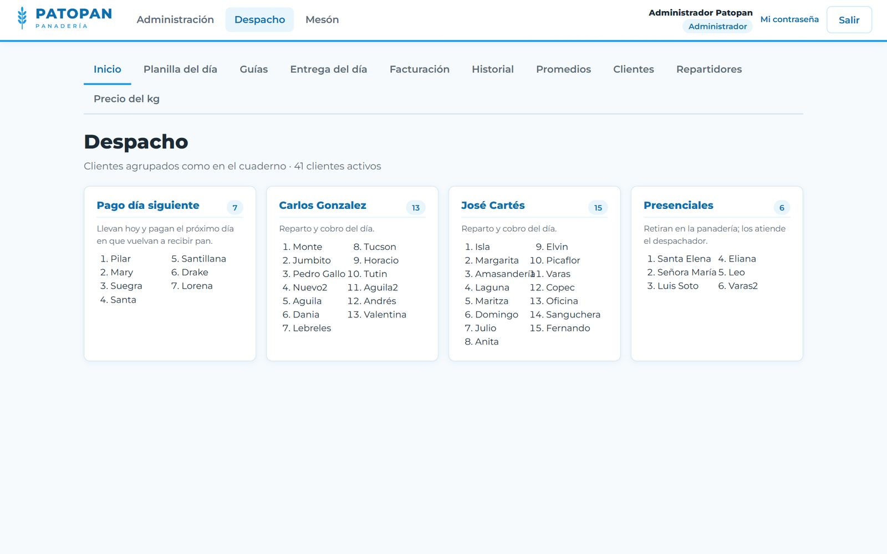
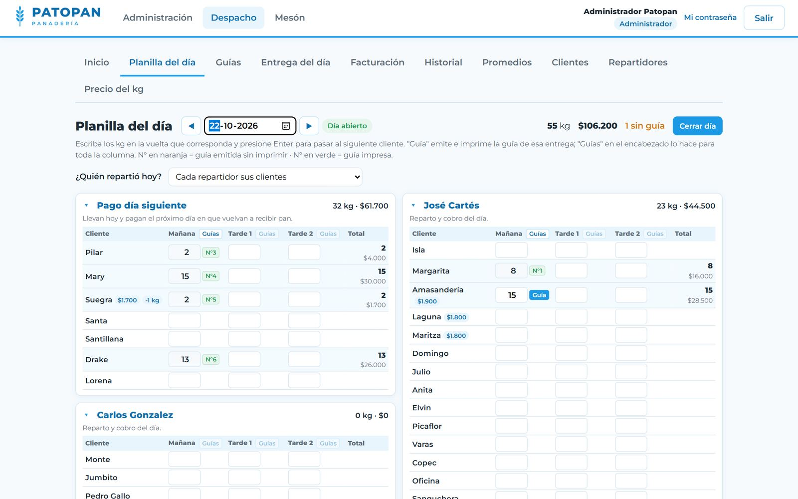
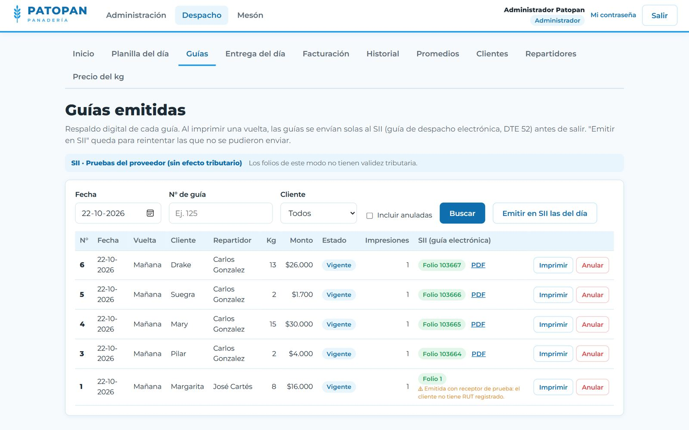
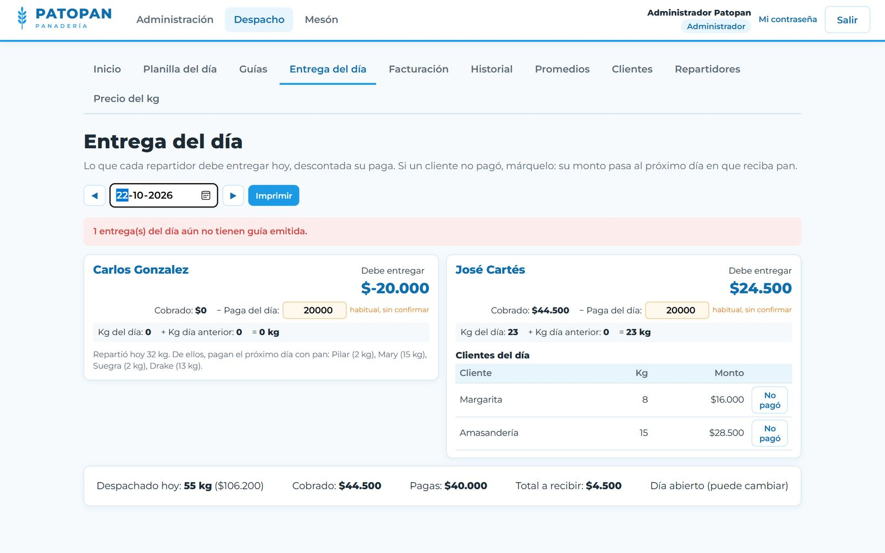
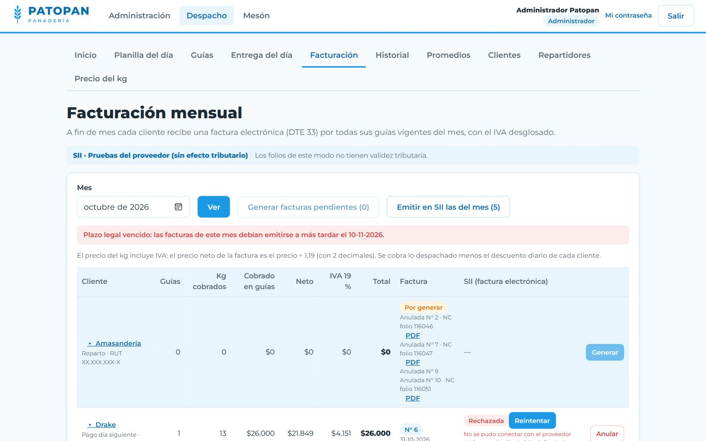
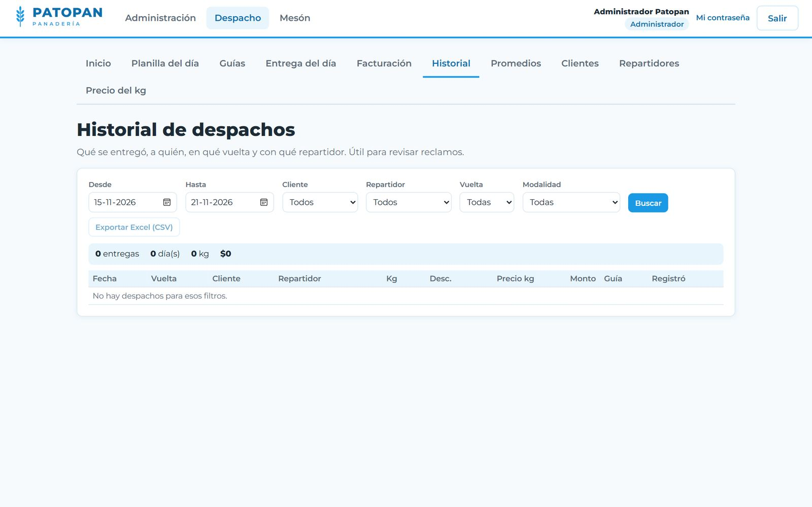
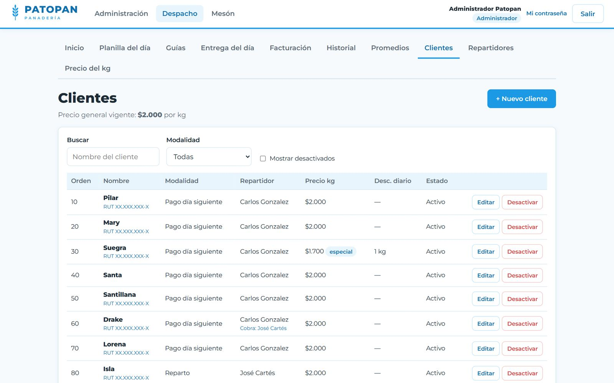
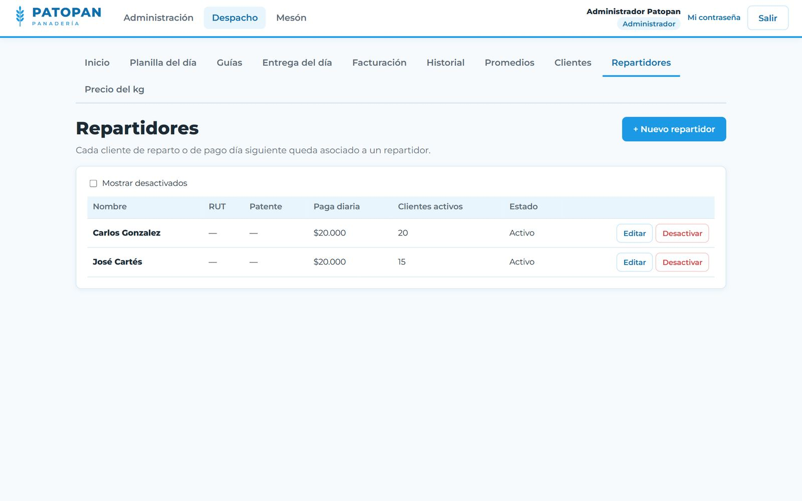

# Manual de usuario · Despacho

Para el **despachador** (usuario con rol *Despacho*). Reemplaza el cuaderno del reparto: registra los kilos de cada cliente, imprime las guías que se envían al SII y calcula cuánto debe entregar cada repartidor.

> Las capturas son del ambiente de pruebas. Los RUT aparecen ocultos (`XX.XXX.XXX-X`).

## 1. Ingresar

1. Abra el navegador en la dirección del sistema (por ejemplo, `http://192.168.1.13:8080` dentro de la panadería).
2. Escriba su usuario y contraseña y presione **Ingresar**.
3. Para cambiar su contraseña use **Mi contraseña** (arriba a la derecha). Para terminar, **Salir**.

## 2. Inicio

Muestra los clientes agrupados como en el cuaderno: **Pago día siguiente**, un grupo por **repartidor** y **Presenciales** (retiran en la panadería).

## 3. Planilla del día (uso diario)

Es el cuaderno digital: una fila por cliente y una columna por vuelta (**Mañana**, **Tarde 1** y **Tarde 2**).

1. Elija la fecha con las flechas ◀ ▶ o el calendario.
2. En **¿Quién repartió hoy?** indique si un solo repartidor hizo todo el reparto.
3. Escriba los **kg** de cada cliente en la columna de la vuelta y presione **Enter**: se guarda y pasa al cliente siguiente. El monto se calcula solo con el precio del kg del cliente.
4. Para imprimir las guías de una vuelta, use el botón **Guías** del encabezado de esa columna. Para un solo cliente, use el botón **Guía** de su fila.

**Qué pasa al imprimir.** El sistema envía cada guía al SII antes de imprimirla (Res. SII 144/2026: la guía debe estar en el SII antes de que salga el reparto) y abre el **PDF timbrado**, que es el documento que lleva el repartidor.

- Si el SII o el proveedor rechazan una guía, se imprime igual con la franja **"SIN FOLIO SII · NO VÁLIDA PARA EL TRASLADO"** y aparece un aviso rojo con el motivo. Corrija el dato (por ejemplo, la patente del furgón) y presione **Reintentar envío al SII**. No salga a repartir con una guía sin folio.
- Después de imprimir, el sistema pregunta **¿Las guías se imprimieron correctamente?** Responda **Sí** solo si salieron bien; desde ese momento una reimpresión sale marcada **COPIA**.
- En la planilla, el N° de guía en **naranja** significa emitida sin imprimir; en **verde**, impresa.

**Corregir los kg de una guía ya emitida.** Anule la guía (ver sección 4), corrija los kg en la planilla y vuelva a imprimirla. La guía nueva queda como reemplazo de la anulada y su guía electrónica hace referencia a ella.

**Cerrar el día.** Al terminar, **Cerrar día** bloquea los cambios. Si hay que corregir algo, **Reabrir** (queda registrado en la auditoría).

## 4. Guías

Respaldo de todas las guías: búsqueda por fecha, número o cliente.

- **PDF**: abre la guía electrónica timbrada.
- **Emitir en SII / Reintentar**: envía al SII una guía que no se pudo enviar al imprimir.
- **Anular**: pide un motivo. Si la guía ya tiene folio del SII, primero anúlela en el *Registro de Guías de Despacho* del portal del SII y luego confirme en el sistema que lo hizo; queda registrado quién y cuándo.

## 5. Entrega del día

Lo que cada repartidor debe entregar, descontada su paga.

1. Revise la **paga del día** de cada repartidor (viene la habitual; se puede cambiar).
2. Si un cliente no pagó, presione **No pagó**: su monto pasa al próximo día en que reciba pan.
3. **Imprimir** entrega una hoja con el resumen para el repartidor.

Abajo se ve el total del día: kg despachados, cobrado, pagas y total a recibir. Si alguna entrega aún no tiene guía, aparece un aviso en rojo.

## 6. Facturación mensual

A fin de mes, cada cliente recibe una factura electrónica por todas sus guías vigentes del mes, con el IVA desglosado.

1. Elija el **Mes** y presione **Ver**.
2. **Generar facturas pendientes** arma las facturas de todos los clientes (o **Generar** en una fila).
3. **Emitir en SII las del mes** envía todas al SII. Una factura rechazada muestra el motivo y el botón **Reintentar**.
4. Para corregir una factura emitida, use **Anular**: el sistema emite una **nota de crédito** en el SII y luego se puede generar la factura de nuevo.

El aviso rojo recuerda el **plazo legal**: las facturas del mes deben emitirse a más tardar el día 10 del mes siguiente.

## 7. Historial y promedios

- **Historial**: qué se entregó, a quién, en qué vuelta y con qué repartidor. Filtra por fechas, cliente, repartidor, vuelta y modalidad; sirve para revisar reclamos. **Exportar Excel (CSV)** descarga el resultado.
- **Promedios**: kg despachados por mes y por cliente, con su promedio mensual y diario. Se marca en naranja a quien cambió su promedio diario en más de un 30 % el último mes (un cliente que compra menos o que se está yendo).

## 8. Clientes, repartidores y precio del kg

- **Clientes**: nombre, RUT, razón social, giro, dirección y comuna (necesarios para el SII), modalidad, repartidor, precio especial y kg de descuento diario. **Desactivar** oculta al cliente sin borrar su historia.
- **Repartidores**: nombre, **RUT y patente del furgón** (el SII los exige en cada guía de reparto) y paga habitual.
- **Precio del kg**: precio general vigente y desde cuándo rige. Los precios especiales se definen en cada cliente.

## Preguntas frecuentes

| Situación | Qué hacer |
|---|---|
| La guía salió "SIN FOLIO SII" | Lea el motivo en el aviso rojo, complete el dato que falta (RUT o patente del repartidor, dirección del cliente) y presione **Reintentar envío al SII**. |
| Me equivoqué en los kg | Anule la guía con un motivo, corrija los kg en la planilla y vuelva a imprimir. |
| Un cliente no pagó | En **Entrega del día**, botón **No pagó** en su fila. |
| La planilla no deja escribir | El día está cerrado: use **Reabrir**. |
