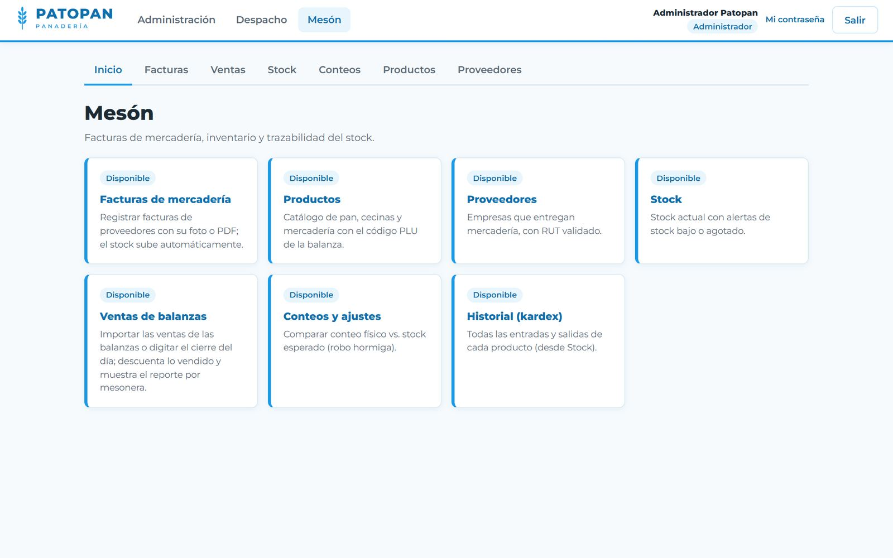
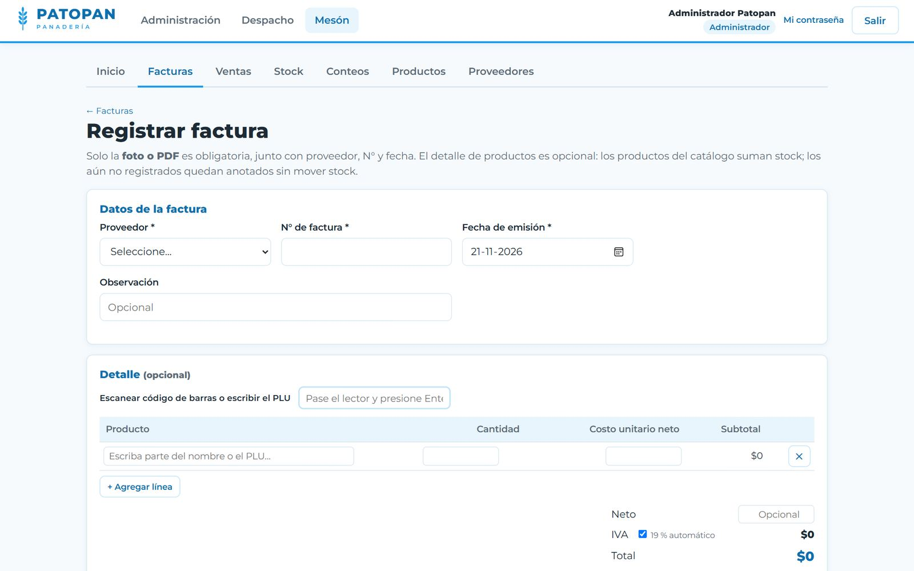
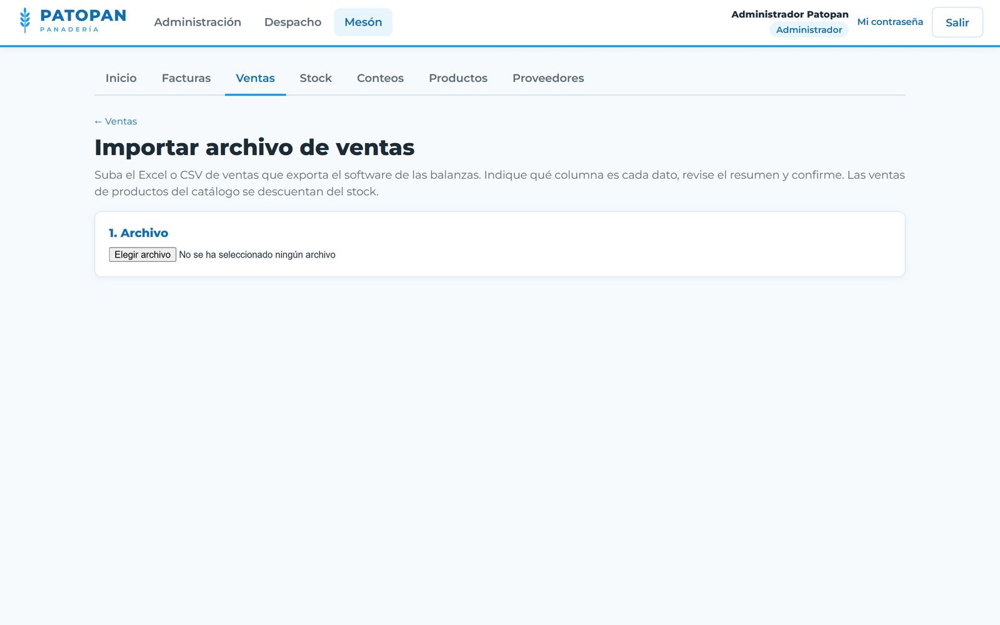
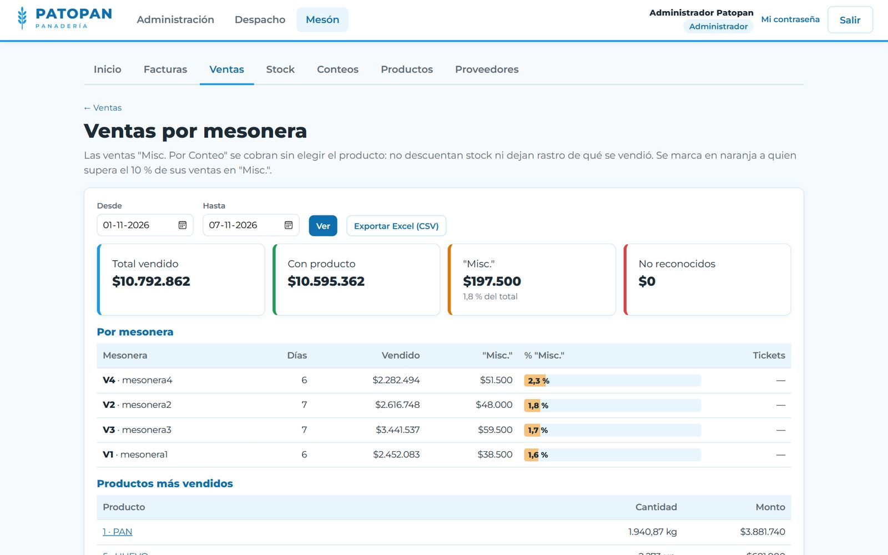
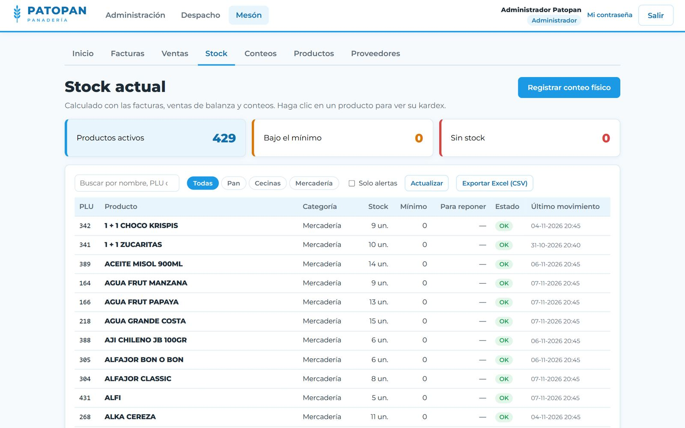
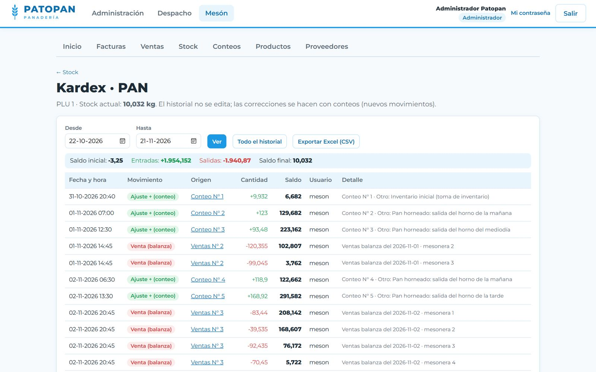
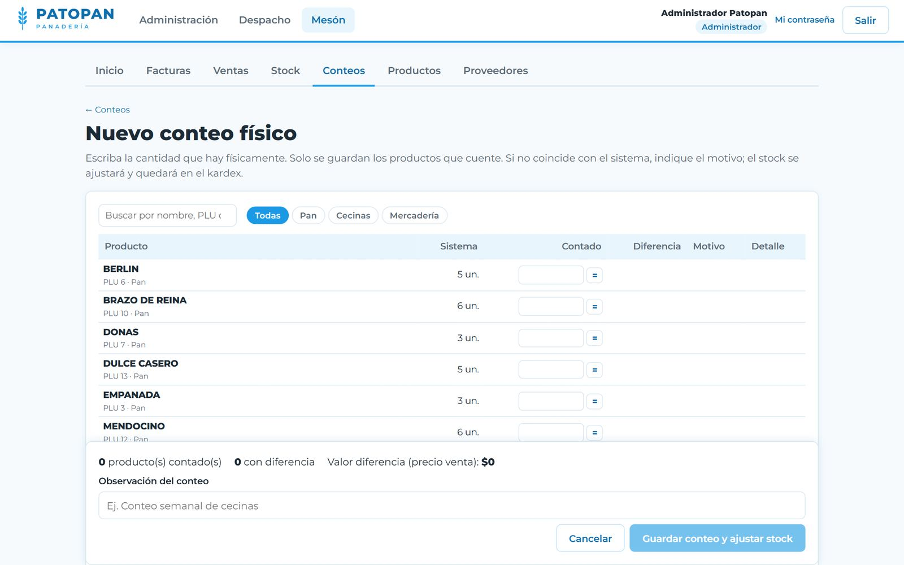
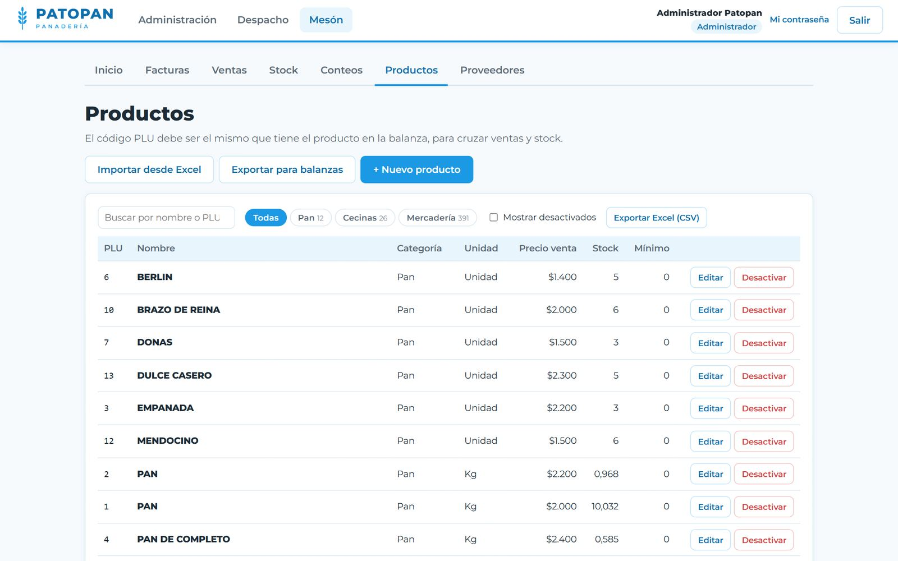

# Manual de usuario · Mesón

Para el **encargado del mesón** (usuario con rol *Mesón*). Controla la mercadería que entra con las facturas de proveedores, la que sale con las ventas de las balanzas y el stock de cada producto.

> Las capturas son del ambiente de pruebas. Los nombres de las mesoneras aparecen reemplazados por su código.

## 1. Ingresar

Igual que en Despacho: navegador en la dirección del sistema, usuario y contraseña. El sistema lo lleva directo al **Inicio de Mesón**.

## 2. Facturas de mercadería (entradas de stock)

1. **Facturas → Nueva factura**.
2. Elija el **proveedor**, escriba el número, la fecha y adjunte la **foto o PDF** de la factura (obligatoria).
3. Agregue las líneas: busque el producto por nombre o PLU, cantidad y costo. El detalle es opcional: sin detalle se puede escribir solo el neto.
4. Al guardar, el **stock sube automáticamente** y cada entrada queda en el historial del producto.

## 3. Ventas de las balanzas (salidas de stock)

Las ventas se descuentan del stock de dos formas:

- **Importar archivo**: suba el Excel o CSV que exporta el software de las balanzas, indique qué columna es cada dato, revise el resumen y confirme. Un mismo archivo no se puede importar dos veces.
- **Cierre del día**: digite el cierre de cada balanza cuando no haya archivo.

### Ventas por mesonera

**Ventas → Reporte**. Muestra, para un rango de fechas, lo vendido por cada mesonera, cuánto se cobró con la tecla **"Misc."** y su porcentaje.

La tecla "Misc." cobra un monto sin elegir el producto: no descuenta stock ni deja registro de qué se vendió. Se marca en **naranja** a quien supera el 10 % de sus ventas en "Misc.". El botón **Exportar Excel (CSV)** descarga el reporte.

## 4. Stock e historial (kardex)

- **Stock** muestra el stock actual de cada producto, con alertas de **bajo el mínimo** y **sin stock**. Filtros por categoría y **Exportar Excel (CSV)**.
- Al hacer clic en un producto se abre su **historial (kardex)**: cada entrada y salida con fecha, origen (factura, venta, conteo) y responsable.

## 5. Conteos físicos (detectar faltantes)

1. **Conteos → Nuevo conteo**.
2. Escriba la cantidad que hay físicamente de cada producto (el botón **=** copia el valor del sistema si coincide). Solo se guardan los productos que cuente.
3. Si hay diferencia, indique el **motivo**. Abajo se ve cuántos productos tienen diferencia y su valor a precio de venta.
4. **Guardar conteo y ajustar stock**: el stock se corrige y el ajuste queda en el kardex.

Un faltante repetido en los conteos es la señal del robo hormiga.

## 6. Productos y proveedores

- **Productos**: catálogo con el **código PLU** de la balanza, código de barras, categoría (pan, cecinas, mercadería), unidad, precio y stock mínimo. Se puede importar desde los archivos de las balanzas (PLUData y ScannerMap).
- **Proveedores**: empresas que entregan mercadería, con RUT validado.

## Preguntas frecuentes

| Situación | Qué hacer |
|---|---|
| Un producto aparece "no reconocido" al importar ventas | Su PLU no está en el catálogo: créelo en **Productos** con ese PLU y vuelva a importar. |
| El stock no coincide con lo que hay | Haga un **conteo** con el motivo; el ajuste queda registrado. |
| No tengo la foto de la factura | La factura no se puede guardar sin respaldo: tome una foto con el celular y súbala. |
