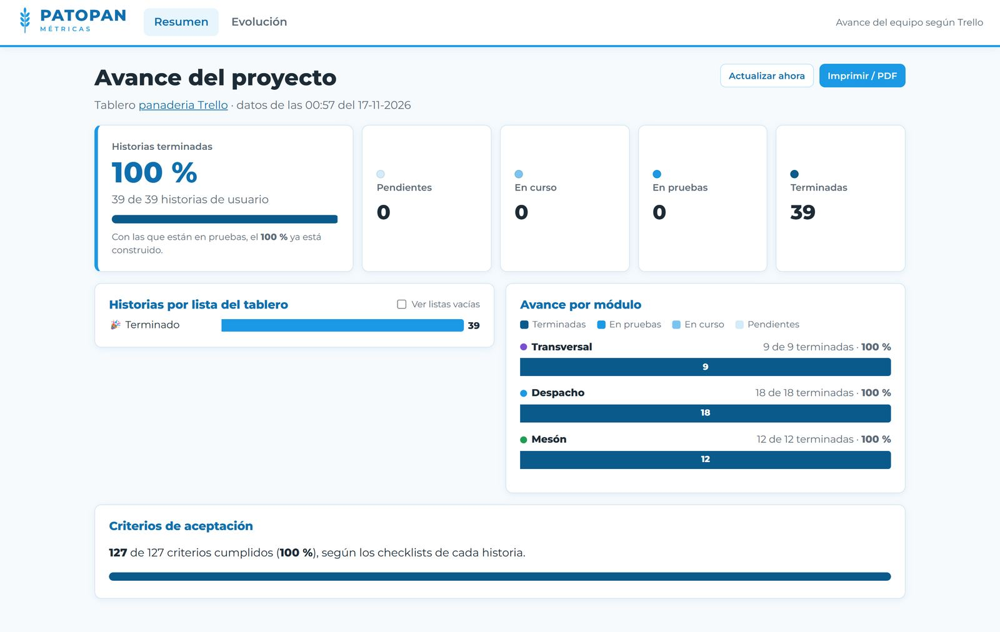
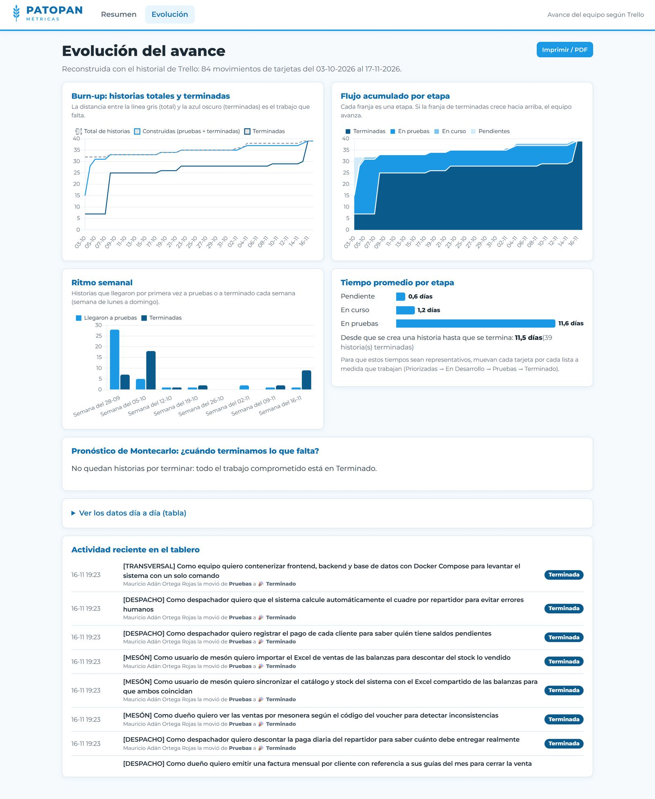

# Métricas del proyecto en Trello

Tablero: [panaderia Trello](https://trello.com/b/y2V28rU9/panaderia-trello). Las métricas se obtienen con **Patopan Métricas** (`ortgvdev/patopan-metricas`), un sistema aparte (Angular + NestJS en Docker) que lee el tablero en vivo, en solo lectura, y reconstruye la evolución con el historial de movimientos de las tarjetas.

## Resumen (17-11-2026)

| Indicador | Valor |
|---|---|
| Tarjetas terminadas | **39 de 39 (100 %)**: 38 historias de usuario y la tarea de la presentación final |
| Criterios de aceptación cumplidos | **127 de 127 (100 %)** |
| Por módulo | Despacho 18 · Mesón 12 · Transversal 9 (todos al 100 %) |
| Movimientos de tarjetas | 84, del 03-10-2026 al 17-11-2026 |
| Tiempo promedio de una historia | 11,5 días desde que se crea hasta terminarla |

## Evolución

| Gráfico | Cómo leerlo | Qué muestra en Patopan |
|---|---|---|
| **Burn-up** | La distancia entre el total de historias y las terminadas es el trabajo que falta. | El total creció de 32 a 39 historias (alcance agregado, como la Res. SII 144/2026) y las terminadas lo alcanzaron el 16-11. |
| **Flujo acumulado** | Cada franja es una etapa; si la de terminadas crece, el equipo avanza. | La franja "en pruebas" fue ancha durante semanas: historias construidas esperando la validación del cliente. |
| **Ritmo semanal** | Historias que llegaron a pruebas o a terminado cada semana. | Dos picos al inicio (base del sistema y despacho) y el cierre la semana del 16-11 con 9 terminadas. |
| **Tiempo por etapa** | Promedio de días en cada etapa. | Pendiente 0,6 días · En curso 1,2 días · **En pruebas 11,6 días**: el cuello de botella fue validar con el cliente, no programar. |
| **Montecarlo** | Simula 10.000 futuros con el ritmo real para estimar cuándo se termina lo pendiente. | Ritmo de 0,87 historias por día; hoy no quedan historias pendientes. |
