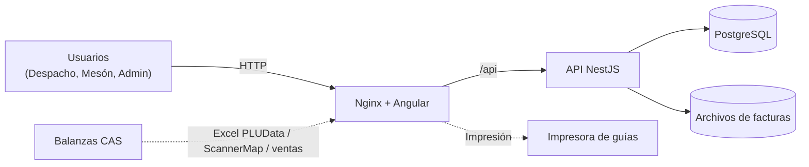

<p align="center">
  
</p>

<h1 align="center">Sistema Web Unificado para la Panadería Patopan</h1>

<p align="center">
  Proyecto Capstone · Ingeniería en Informática · Duoc UC · 2026
</p>

---

## Integrantes

| Integrante | Rol en el proyecto |
|---|---|
| Javier Molina | _Por completar_ |
| Mauricio Ortega | _Por completar_ |
| Pablo Gonzalez | _Por completar_ |

**Docente guía:** _Por completar_ · **Sección:** _Por completar_

---

## 1. Contexto y problemática

La Panadería Patopan opera dos áreas con procesos mayoritariamente manuales:

- **Despacho de pan a clientes:** los kilos despachados por cliente y vuelta se anotan en un cuaderno, del que luego se calculan a mano las guías, los cobros de cada repartidor y las deudas de los clientes. Esto provoca errores de cálculo, poca trazabilidad de los pagos y dificultad para obtener historiales y promedios de consumo.
- **Mesón de venta:** las facturas de mercadería, el inventario y las ventas de las balanzas etiquetadoras no están integrados. No existe un registro del stock real, de las mermas ni de las ventas por mesonera.

## 2. Objetivos

### Objetivo general

Desarrollar un sistema web unificado que digitalice la gestión del despacho y del mesón de la Panadería Patopan, con trazabilidad completa de las operaciones y control de acceso por rol.

### Objetivos específicos

1. Reemplazar el cuaderno de despacho por una planilla digital diaria, con generación de guías y cuadre por repartidor.
2. Llevar el registro de pagos y saldos por cliente, con historial de despachos y promedios mensuales de consumo.
3. Controlar el inventario del mesón a partir de las facturas de mercadería, las ventas de las balanzas y los conteos físicos (kardex).
4. Integrar el catálogo y las ventas de las balanzas CAS mediante la importación y exportación de archivos Excel.
5. Asegurar la trazabilidad mediante autenticación por roles y auditoría de cada operación que modifica datos.

## 3. Alcance de la solución

| Módulo | Funcionalidades principales |
|---|---|
| **Despacho** | Clientes, repartidores y precios por kg · Planilla diaria (3 vueltas) · Guías imprimibles · Cuadre por repartidor · Pagos y saldos · Historial y promedios mensuales |
| **Mesón** | Productos y proveedores · Facturas con foto/PDF adjunto · Stock con alertas · Kardex por producto · Conteos físicos con motivo · Integración con balanzas CAS (PLUData, ScannerMap, ventas y reporte por mesonera) · Búsqueda por código de barras |
| **Administración** | Usuarios y roles · Cierre de sesiones · Auditoría con filtros y comparación antes/después |

## 4. Tecnologías

| Capa | Tecnología | Justificación |
|---|---|---|
| Frontend | **Angular 19** (componentes standalone, signals) | Tipado fuerte y adecuado para formularios intensivos. |
| Backend (API REST) | **NestJS 11** (Node.js 22, TypeScript) | Mismo lenguaje en todo el stack; arquitectura modular por dominio; guards y DTOs con validación. |
| ORM y migraciones | **Prisma 6** | Esquema declarativo, migraciones versionadas y transacciones para el stock. |
| Base de datos | **PostgreSQL 16** | Motor relacional con tipos `DECIMAL` exactos para kilos y montos. |
| Servidor web | **Nginx** | Sirve el frontend y redirige `/api` al backend en el mismo origen. |
| Contenedores | **Docker Compose** | Despliegue reproducible con un solo comando. |
| Seguridad | **JWT** + **bcrypt** | Sesiones por rol con revocación; contraseñas almacenadas con hash. |
| Gestión | **Trello** + **GitHub** | Tablero Kanban de historias de usuario y flujo de ramas con Pull Requests. |

### Arquitectura general



El detalle se encuentra en [Arquitectura](Fase%202/Evidencias%20Grupales/1.%20Documentaci%C3%B3n%20t%C3%A9cnica/arquitectura.md) y [Modelo de datos](Fase%202/Evidencias%20Grupales/1.%20Documentaci%C3%B3n%20t%C3%A9cnica/modelo-datos.md).

## 5. Metodología de trabajo

- **Marco ágil con tablero Kanban en Trello.** Las historias de usuario están organizadas por módulo (Transversal, Despacho, Mesón), con criterios de aceptación, y avanzan por las etapas *Ideas → Análisis → Desarrollo → Pruebas → Terminado*.
- **Control de versiones con GitHub.** Cada funcionalidad se desarrolla en una rama propia (`feature/...`) y se integra a `main` mediante un Pull Request.
- **Validación con el cliente.** Las reglas de negocio (precios, vueltas, cobro y saldos, formato de guías) se confirman con la panadería y se registran en la bitácora.
- **Métricas de avance.** Se usa un sistema complementario, *Patopan Métricas*, que lee el tablero de Trello y muestra el avance por etapa y por módulo, un gráfico burn-up, el flujo acumulado y el ritmo semanal.

## 6. Estructura del repositorio

```
.
├── README.md
├── Fase 1/
│   ├── Evidencias Grupales/
│   └── Evidencias Individuales/
├── Fase 2/                              → Desarrollo del sistema
│   ├── Evidencias Grupales/
│   │   ├── 1. Documentación técnica/    → arquitectura, modelo de datos, informes de investigación
│   │   ├── 2. Gestión del proyecto/     → bitácora, capturas de Trello y métricas
│   │   ├── 3. Código fuente/            → enlace a los repositorios y versión entregada
│   │   ├── 4. Pruebas/                  → casos y evidencias de pruebas
│   │   ├── 5. Registro visual/          → capturas del sistema funcionando
│   │   └── 6. Reuniones con el cliente/ → actas y decisiones
│   └── Evidencias Individuales/         → una carpeta por integrante
└── Fase 3/                              → Cierre y presentación
    ├── Evidencias Grupales/             → informe final, presentación, manuales y video
    └── Evidencias Individuales/
```

## 7. Código fuente

| Repositorio | Descripción |
|---|---|
| [`ortgvdev/patopan`](https://github.com/ortgvdev/patopan) | Sistema web Patopan (frontend, backend, base de datos y Docker Compose). |
| `patopan-metricas` | Panel de métricas de avance del equipo a partir de Trello. |

### Ejecución local

Requisitos: Git y Docker Desktop.

```bash
git clone https://github.com/ortgvdev/patopan.git
cd patopan
cp .env.example .env        # ajustar la clave de la base de datos y el secreto JWT
docker compose up -d --build
```

El sistema queda disponible en `http://localhost:8080`. Las instrucciones completas están en el README del repositorio de código.

## 8. Estado de avance

| Módulo | Estado |
|---|---|
| Base técnica (autenticación, roles, auditoría) | Terminado |
| Despacho: maestros, planilla, guías y cuadre | En pruebas |
| Despacho: pagos, saldos, historial y promedios | En pruebas |
| Mesón: catálogo, facturas e inventario | En pruebas |
| Mesón: integración con balanzas CAS | En pruebas (pendiente la conexión física de un PC a las balanzas) |
| Administración: usuarios y auditoría | En pruebas |

---

<sub>Proyecto académico desarrollado para la asignatura Capstone de Duoc UC. El uso de los datos de la Panadería Patopan está limitado a fines académicos.</sub>
