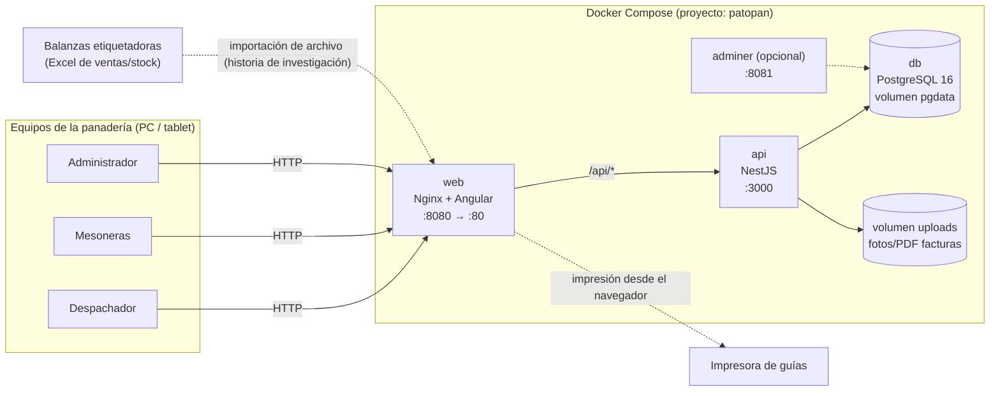

# Arquitectura del sistema Patopan

> Historia: **[TRANSVERSAL] Definir la arquitectura y el stack tecnológico para construir un sistema web unificado**

## 1. Objetivo

Un **único sistema web** con dos secciones: **Despacho**, que reemplaza el cuaderno de reparto, y **Mesón**, que cubre facturas de mercadería, inventario e integración con las balanzas etiquetadoras. Ambas comparten la base de datos, el inicio de sesión y la auditoría.

## 2. Stack tecnológico

| Capa | Tecnología | Justificación |
|---|---|---|
| Frontend | **Angular 19** (standalone components, signals) | Tecnología conocida por el equipo, tipado fuerte, ideal para formularios (planilla de kg, facturas). |
| Backend (API REST) | **NestJS 11** (Node.js + TypeScript) | Mismo lenguaje que Angular (TypeScript en todo el stack). Arquitectura modular (un módulo por dominio), guards para roles, validación declarativa con DTOs. |
| ORM / migraciones | **Prisma 6** | Esquema declarativo legible (`schema.prisma`), migraciones versionadas, cliente tipado y transacciones para el stock. |
| Base de datos | **PostgreSQL 16** | Relacional y robusta, con tipos `DECIMAL` exactos para kg y montos. Es libre. |
| Servidor web / proxy | **Nginx** | Sirve el frontend compilado y redirige `/api` al backend, así todo queda en un mismo origen y sin CORS. |
| Contenedores | **Docker + Docker Compose** | Despliegue reproducible con un solo comando, en cualquier equipo de la panadería. |
| Autenticación | **JWT** + **bcrypt** | Sesiones sin estado; contraseñas con hash, nunca en texto plano. |

## 3. Diagrama de contenedores



## 4. Arquitectura del backend (NestJS)

```
backend/src/
├── main.ts                  → arranque, prefijo /api, validación global, límite de cuerpo 15 MB
├── app.module.ts            → guards globales (JWT + roles) e interceptor de auditoría
├── prisma/                  → acceso a la base de datos (PrismaService)
├── auth/                    → login, /auth/me, cambio de contraseña propio, emisión de JWT
├── usuarios/                → gestión de usuarios y roles (solo ADMIN)
├── mantencion/              → limpieza de datos de prueba de Despacho (solo ADMIN)
├── audit/                   → registro y consulta de auditoría (solo ADMIN)
├── common/
│   ├── decorators/          → @Public(), @Roles(), @CurrentUser()
│   ├── guards/              → JwtAuthGuard (valida usuario activo y versión del token), RolesGuard
│   └── interceptors/        → AuditInterceptor (registra POST/PUT/PATCH/DELETE)
├── health/                  → /api/health (healthcheck de Docker)
│
├── clientes/  repartidores/  precios/        → DESPACHO: maestros
├── planilla/  guias/  entrega/              → DESPACHO: operación diaria y entrega del día por repartidor
├── dte/                                      → DESPACHO: guía de despacho electrónica (DTE 52) vía proveedor con API
├── reportes/                                 → DESPACHO: historial y promedios mensuales
│
├── productos/  proveedores/                  → MESÓN: catálogo (importación/exportación CAS)
├── facturas/                                 → MESÓN: facturas de mercadería con archivo adjunto
├── inventario/                               → MESÓN: stock, kardex, conteos y registrarMovimiento()
└── ventas/                                   → MESÓN: ventas de balanza, cierre manual, reporte por mesonera
```

**Convención para nuevos módulos:** un directorio por dominio (`facturas/`, `productos/`, `guias/`…) con `*.module.ts`, `*.controller.ts`, `*.service.ts` y `dto/`. La seguridad se declara con `@Roles('DESPACHO')` o `@Roles('MESON')`.

### Seguridad

- **Todo endpoint requiere sesión**, salvo los marcados con `@Public()` (login y health).
- **Roles:** `ADMIN` (acceso total), `MESON` y `DESPACHO`.
- **Auditoría automática:** cada operación que modifica datos queda registrada con usuario, ruta, cuerpo (sin contraseñas), IP, fecha y resultado. También se registran los ingresos (`LOGIN`) y los intentos fallidos (`LOGIN_FALLIDO`).
- **Datos críticos:** las guías y facturas no se borran ni se editan; solo se anulan con un motivo. El stock se modifica únicamente a través de movimientos (kardex).

## 5. Arquitectura del frontend (Angular)

```
frontend/src/app/
├── core/       → AuthService (sesión), guards por rol, interceptor del token, modelos
├── layout/     → Shell (encabezado + menú por rol), Logo Patopan
└── pages/
    ├── login/
    ├── despacho/
    ├── meson/
    └── admin/
```

- Rutas con **carga diferida** (lazy loading) por sección.
- Al iniciar sesión, cada rol llega a su inicio: `despachador → /despacho`, `meson → /meson`, `admin → /admin`.
- Identidad visual: celeste `#1B99E5` y blanco, con tipografía **Montserrat** y un logo propio de espiga de trigo + "PATOPAN" (`docs/img/logo-patopan.svg`). Las fuentes se incluyen en el proyecto, así el sistema funciona aunque no haya internet.

## 6. Decisiones de integración

| Tema | Historia relacionada | Estado |
|---|---|---|
| Formato del Excel de las balanzas | [MESÓN] Investigar modelo y formato de exportación de las balanzas | **Resuelto.** Balanzas CAS CN1-30P; archivos `PLUData` (catálogo) y `ScannerMap` (códigos de barras). Patopan es el catálogo maestro. Ver `informe-balanzas.md`. |
| Exportación de ventas desde las balanzas | [MESÓN] Importar ventas de la balanza | **Parcial.** Importación por archivo con mapeo de columnas y cierre manual desde el reporte X, mientras no haya un PC conectado a las balanzas. |
| Guía de despacho electrónica (SII) | [DESPACHO] Emitir la guía en el SII | **Implementado** con un proveedor certificado con API (OpenFactura), módulo `dte/` independiente del proveedor. Modos `simulado`, `pruebas` (sin efecto tributario) y `produccion` (requiere certificado digital, folios CAF y contrato). |
| Tipo de impresora para guías | [DESPACHO] Generar e imprimir una guía por caja | **Definido:** hoja carta, una guía por cliente y vuelta. Falta la prueba en la impresora real. |
| Precio del kg de pan | [DESPACHO] Configurar el precio del kg | **Resuelto:** $2.000/kg general, con precios especiales por cliente. |
