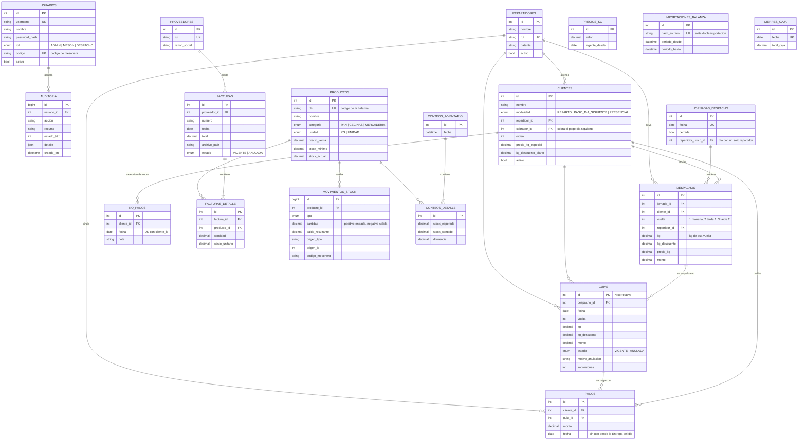

# Modelo de datos unificado

> Historia: **[TRANSVERSAL] Diseñar el modelo de datos unificado para soportar despacho e inventario en una sola base de datos**
> Fuente de verdad: `backend/prisma/schema.prisma`

## Diagrama entidad-relación

## Reglas de negocio reflejadas en el modelo

| Regla | Cómo se cumple |
|---|---|
| Replicar las secciones del cuaderno | `clientes.modalidad` + `clientes.repartidor_id` + `clientes.orden` |
| "Pago día siguiente": quién cobra | `clientes.cobrador_id` (ej. Drake → José Cartés, el resto → Carlos Gonzalez); null = el mismo repartidor. Si ese día reparte uno solo (`jornadas_despacho.repartidor_unico_id`), cobra él todo |
| 3 vueltas al día como las columnas del cuaderno (mañana, tarde 1, tarde 2) | `despachos.vuelta` + `UNIQUE(jornada_id, cliente_id, vuelta)` |
| Una guía por vuelta; corregir kg exige anularla | `guias.vuelta` + `guias.estado` + validación en la API |
| El descuento diario se aplica una sola vez al día | Se asigna a la primera vuelta con pan (`despachos.kg_descuento`) |
| Cobro de "pago día siguiente" | Se cobra el **próximo día en que el cliente vuelva a recibir pan** (si no trabaja el sábado, lo del viernes se cobra el domingo; si faltan varios días, se junta) |
| Cerrar el día bloquea la edición | `jornadas_despacho.cerrada` |
| Se asume que todos pagan; solo se anotan excepciones | `no_pagos` con `UNIQUE(cliente_id, fecha)`: lo que debía ese día pasa a su próximo día con pan. La tabla `pagos` queda sin uso (reemplazada por la Entrega del día) |
| Entrega del día por repartidor | Se calcula desde la planilla: clientes de reparto del día (los rinde quien repartió) + pago día siguiente que corresponde cobrar hoy (los rinde su cobrador). Presenciales aparte |
| Día con un solo repartidor | `repartidor_unico_id`: las líneas del día quedan a su nombre y cobra todo el pago día siguiente |
| Precio especial por cliente | `clientes.precio_kg_especial` (null = precio general vigente) |
| Kg no cobrados cada día (ej. Suegra: 1 kg) | `clientes.kg_descuento_diario` → monto = (kg − descuento) × precio |
| Un cambio de precio no altera guías emitidas | `precio_kg` se copia en `despachos` y `guias` al momento de emitir |
| Guía y factura no se editan, solo se anulan | `estado` + `motivo_anulacion` (+ quién y cuándo) |
| Factura sin duplicados | `UNIQUE(proveedor_id, numero)` |
| Registrar una factura suma al stock | Cada línea genera un movimiento `ENTRADA_FACTURA` en la misma transacción |
| Anular una factura revierte el stock sin borrar historial | Movimientos `ANULACION_FACTURA` negativos + `estado`, motivo, quién y cuándo |
| Neto, IVA y total | `facturas.neto` = Σ subtotales; `iva` = 19 % del neto (editable); `total` = neto + IVA |
| Respaldo de la factura | Foto/PDF en el volumen `uploads`; se valida el tipo real del archivo y el anterior se conserva |
| Cruce con balanzas | `productos.plu` único, igual al código de la balanza |
| No importar dos veces las mismas ventas | `importaciones_balanza.hash_archivo` único (hash del contenido) + no se aceptan dos cargas vigentes que cubran el mismo día |
| Patopan es el catálogo maestro de las balanzas | Importar productos desde el Excel de las balanzas (por PLU) y exportarlos de vuelta en Excel |
| Formato de las balanzas CAS (PLUData y ScannerMap) | `Tipo de PLU` 1 = por peso (KG), 2 = por unidad; `Código de mapeo` del ScannerMap = código de barras → `productos.codigo_barras` (puede repetirse) |
| Tecla "PRODUCTO VARIO" (PLU 1) | No se importa como producto; sus ventas cuentan como "Misc." |
| Ventas de la balanza descuentan stock | `ventas_balanza` (PRODUCTO / MISC / SIN_PRODUCTO); solo PRODUCTO genera `SALIDA_VENTA`; anular la carga genera `ANULACION_VENTA` |
| Ventas por mesonera y "Misc. Por Conteo" | `resumen_mesoneras` por día y código de mesonera (CLERK del voucher = `usuarios.codigo`) |
| Trazabilidad del stock (robo hormiga) | `movimientos_stock` es inmutable y guarda origen, usuario y código de mesonera |
| Conteo físico vs. sistema | `conteos_detalle` guarda esperado, contado y diferencia; cada diferencia exige motivo y genera `AJUSTE_POSITIVO`/`AJUSTE_NEGATIVO` |
| Un solo punto de cambio del stock | Función `registrarMovimiento`: actualiza `productos.stock_actual` y deja el movimiento con su saldo |
| Kg y montos exactos | `DECIMAL(10,3)` para kg y `DECIMAL(12,2)` para montos (nunca `float`) |
| Eliminación lógica | Campo `activo` en usuarios, clientes, repartidores, productos y proveedores |
| Trazabilidad general | Tabla `auditoria` + campos `creado_por_id` / `creado_en` |

## Datos iniciales (seed)

**Precios (cargados solo la primera vez):** precio general **$2.000/kg**. Condiciones especiales: **Suegra** $1.700/kg con 1 kg de descuento diario, **Amasandería** $1.900/kg, **Laguna** y **Maritza** $1.800/kg.

El archivo `backend/prisma/seed.js` carga automáticamente, y sin duplicar si se vuelve a ejecutar:

- **Usuarios:** `admin / adminpatopan`, `meson / mesonpatopan`, `despachador / despachadorpatopan`
- **Repartidores:** Repartidor 1 y Repartidor 2
- **40 clientes del cuaderno**, en el mismo orden y con su modalidad:
  - Pago día siguiente (7): Pilar, Mary, Suegra, Santa, Santillana, Drake, Lorena
  - Repartidor 1 (14): Isla, Margarita, Amasandería, Laguna, Maritza, Domingo, Julio, Anita, Elvin, Picaflor, Varas, Copec, Oficina, Sanguchera
  - Repartidor 2 (13): Monte, Jumbito, Pedro Gallo, Nuevo2, Aguila, Dania, Lebreles, Tucson, Horacio, Tutin, Aguila2, Andrés, Valentina
  - Presenciales (6): Santa Elena, Señora María, Luis Soto, Eliana, Leo, Varas2
