# Modelo de datos unificado

> Historia: **[TRANSVERSAL] Diseñar el modelo de datos unificado para soportar despacho e inventario en una sola base de datos**
> Fuente de verdad: `backend/prisma/schema.prisma`

## Diagrama entidad-relación

```mermaid
erDiagram
    USUARIOS ||--o{ AUDITORIA : "genera"

    REPARTIDORES ||--o{ CLIENTES : "atiende"
    CLIENTES ||--o{ DESPACHOS : "recibe"
    JORNADAS_DESPACHO ||--o{ DESPACHOS : "contiene"
    REPARTIDORES ||--o{ DESPACHOS : "lleva"
    DESPACHOS ||--o{ GUIAS : "se respalda en"
    GUIAS |o--o| GUIAS : "reemplaza a"
    GUIAS |o--o| DOCUMENTOS_SII : "DTE 52"
    CLIENTES ||--o{ PAGOS : "realiza"
    GUIAS ||--o{ PAGOS : "se paga con"
    REPARTIDORES ||--o{ PAGOS : "rinde"
    CLIENTES ||--o{ NO_PAGOS : "excepcion de cobro"
    CLIENTES ||--o{ FACTURAS_MENSUALES : "recibe"
    FACTURAS_MENSUALES ||--o{ GUIAS : "cobra"
    FACTURAS_MENSUALES ||--o| NOTAS_CREDITO : "se anula en el SII con"
    FACTURAS_MENSUALES |o--o| DOCUMENTOS_SII : "DTE 33"
    NOTAS_CREDITO |o--o| DOCUMENTOS_SII : "DTE 61"
    REPARTIDORES ||--o{ PAGAS_REPARTIDOR : "recibe"

    PROVEEDORES ||--o{ FACTURAS : "emite"
    FACTURAS ||--|{ FACTURAS_DETALLE : "contiene"
    PRODUCTOS ||--o{ FACTURAS_DETALLE : ""
    PRODUCTOS ||--o{ MOVIMIENTOS_STOCK : "kardex"
    CONTEOS_INVENTARIO ||--|{ CONTEOS_DETALLE : "contiene"
    PRODUCTOS ||--o{ CONTEOS_DETALLE : ""
    IMPORTACIONES_BALANZA ||--o{ VENTAS_BALANZA : "contiene"
    IMPORTACIONES_BALANZA ||--o{ RESUMEN_MESONERAS : "contiene"
    PRODUCTOS ||--o{ VENTAS_BALANZA : ""
    USUARIOS ||--o{ VENTAS_BALANZA : "codigo de mesonera"
    USUARIOS ||--o{ RESUMEN_MESONERAS : "codigo de mesonera"
    USUARIOS ||--o{ MOVIMIENTOS_STOCK : "codigo de mesonera"

    USUARIOS {
        int id PK
        string username UK
        string nombre
        string password_hash
        enum rol "ADMIN | MESON | DESPACHO"
        string codigo UK "codigo de mesonera"
        bool activo
    }
    AUDITORIA {
        bigint id PK
        int usuario_id FK
        string accion
        string recurso
        int estado_http
        json detalle
        datetime creado_en
    }
    REPARTIDORES {
        int id PK
        string nombre
        string rut UK
        string patente
        decimal paga_diaria "habitual por dia"
        bool activo
    }
    CLIENTES {
        int id PK
        string nombre
        enum modalidad "REPARTO | PAGO_DIA_SIGUIENTE | PRESENCIAL"
        int repartidor_id FK
        int cobrador_id FK "cobra el pago dia siguiente"
        int orden
        decimal precio_kg_especial
        decimal kg_descuento_diario
        bool activo
    }
    PRECIOS_KG {
        int id PK
        decimal valor
        date vigente_desde
    }
    JORNADAS_DESPACHO {
        int id PK
        date fecha UK
        bool cerrada
        int repartidor_unico_id FK "dia con un solo repartidor"
    }
    DESPACHOS {
        int id PK
        int jornada_id FK
        int cliente_id FK
        int vuelta "1 manana, 2 tarde 1, 3 tarde 2"
        int repartidor_id FK
        decimal kg "kg de esa vuelta"
        decimal kg_descuento
        decimal precio_kg "monto = (kg - kg_descuento) x precio_kg, se calcula"
    }
    GUIAS {
        int id PK "N correlativo"
        int despacho_id FK "cliente, repartidor, fecha y vuelta vienen del despacho"
        decimal kg "copia del documento emitido"
        decimal kg_descuento
        decimal precio_kg
        decimal monto
        enum estado "VIGENTE | ANULADA"
        string motivo_anulacion
        int impresiones
        int documento_sii_id FK,UK "null = solo interna"
        int reemplaza_a_id FK,UK "guia anulada que corrige"
        int factura_mensual_id FK "null = sin facturar"
    }
    DOCUMENTOS_SII {
        int id PK
        int tipo "52 guia | 33 factura | 61 nota de credito"
        enum estado "NO_ENVIADA | EMITIDA | RECHAZADA"
        int folio "folio oficial SII"
        string ambiente "SIMULADO | PRUEBAS | PRODUCCION"
        int intentos
        string error
        string pdf_path
        string xml_path
        datetime emitido_en
        datetime anulado_en "guia anulada a mano en el SII"
    }
    FACTURAS_MENSUALES {
        int id PK
        int cliente_id FK
        date periodo "primer dia del mes"
        date fecha_emision
        decimal neto
        decimal iva
        decimal total
        json detalle "una linea por precio del kg"
        enum estado "VIGENTE | ANULADA"
        int documento_sii_id FK,UK
    }
    NOTAS_CREDITO {
        int id PK
        int factura_mensual_id FK,UK "una por factura"
        date fecha
        string motivo "montos = los de su factura"
        int documento_sii_id FK,UK
    }
    PAGOS {
        int id PK
        int cliente_id FK
        int guia_id FK
        decimal monto
        date fecha "sin uso desde la Entrega del dia"
    }
    PAGAS_REPARTIDOR {
        int id PK
        date fecha
        int repartidor_id FK
        decimal monto
    }
    NO_PAGOS {
        int id PK
        int cliente_id FK
        date fecha "UK con cliente_id"
        string nota
    }
    PRODUCTOS {
        int id PK
        string plu UK "codigo de la balanza"
        string nombre
        enum categoria "PAN | CECINAS | MERCADERIA"
        enum unidad "KG | UNIDAD"
        decimal precio_venta
        decimal stock_minimo
        decimal stock_actual
    }
    PROVEEDORES {
        int id PK
        string rut UK
        string razon_social
    }
    FACTURAS {
        int id PK
        int proveedor_id FK
        string numero
        date fecha
        decimal total
        string archivo_path
        enum estado "VIGENTE | ANULADA"
    }
    FACTURAS_DETALLE {
        int id PK
        int factura_id FK
        int producto_id FK "null = no registrado"
        string descripcion
        decimal cantidad
        decimal costo_unitario "subtotal = cantidad x costo, se calcula"
    }
    MOVIMIENTOS_STOCK {
        bigint id PK
        int producto_id FK
        enum tipo
        decimal cantidad "positivo entrada, negativo salida"
        decimal saldo_resultante
        string origen_tipo
        int origen_id
        string codigo_mesonera FK "usuarios.codigo"
    }
    IMPORTACIONES_BALANZA {
        int id PK
        string hash_archivo UK "evita doble importacion"
        datetime periodo_desde
        datetime periodo_hasta "total = suma de sus ventas, se calcula"
    }
    VENTAS_BALANZA {
        int id PK
        int importacion_id FK
        date fecha
        int producto_id FK "null = Misc. o sin producto"
        enum tipo "PRODUCTO | MISC | SIN_PRODUCTO"
        decimal cantidad
        decimal monto
        string codigo_mesonera FK "usuarios.codigo"
    }
    RESUMEN_MESONERAS {
        int id PK
        int importacion_id FK
        date fecha
        string codigo_mesonera FK "usuarios.codigo"
        decimal monto
        decimal monto_misc
    }
    CONTEOS_INVENTARIO {
        int id PK
        datetime fecha
    }
    CONTEOS_DETALLE {
        int id PK
        decimal stock_esperado
        decimal stock_contado "diferencia = contado - esperado, se calcula"
        string motivo
    }
    CIERRES_CAJA {
        int id PK
        date fecha UK
        decimal total_caja
    }
```

## Reglas de negocio reflejadas en el modelo

| Regla | Cómo se cumple |
|---|---|
| Replicar las secciones del cuaderno | `clientes.modalidad` + `clientes.repartidor_id` + `clientes.orden` |
| "Pago día siguiente": quién cobra | `clientes.cobrador_id` (ej. Drake → José Cartés, el resto → Carlos Gonzalez); null = el mismo repartidor. Si ese día reparte uno solo (`jornadas_despacho.repartidor_unico_id`), cobra él todo |
| 3 vueltas al día como las columnas del cuaderno (mañana, tarde 1, tarde 2) | `despachos.vuelta` + `UNIQUE(jornada_id, cliente_id, vuelta)` |
| Una guía por vuelta; corregir kg exige anularla | La guía cuelga de su línea (`guias.despacho_id`, que ya define cliente, día y vuelta) + `guias.estado` + validación en la API. La guía nueva apunta a la anulada (`guias.reemplaza_a_id`) |
| El descuento diario se aplica una sola vez al día | Se asigna a la primera vuelta con pan (`despachos.kg_descuento`) |
| Cobro de "pago día siguiente" | Se cobra el **próximo día en que el cliente vuelva a recibir pan** (si no trabaja el sábado, lo del viernes se cobra el domingo; si faltan varios días, se junta) |
| Cerrar el día bloquea la edición | `jornadas_despacho.cerrada` |
| Se asume que todos pagan; solo se anotan excepciones | `no_pagos` con `UNIQUE(cliente_id, fecha)`: lo que debía ese día pasa a su próximo día con pan. La tabla `pagos` queda sin uso (reemplazada por la Entrega del día) |
| Entrega del día por repartidor | Se calcula desde la planilla: clientes de reparto del día (los rinde quien repartió) + pago día siguiente que corresponde cobrar hoy (los rinde su cobrador). Presenciales aparte |
| Paga del repartidor | `repartidores.paga_diaria` (habitual, $20.000) y `pagas_repartidor` (la de cada día, `UNIQUE(fecha, repartidor_id)`). Entrega = cobrado − paga |
| Día con un solo repartidor | `repartidor_unico_id`: las líneas del día quedan a su nombre y cobra todo el pago día siguiente |
| Precio especial por cliente | `clientes.precio_kg_especial` (null = precio general vigente) |
| Kg no cobrados cada día (ej. Suegra: 1 kg) | `clientes.kg_descuento_diario` → monto = (kg − descuento) × precio |
| Un cambio de precio no altera guías emitidas | `despachos.precio_kg` guarda el precio vigente al registrar la línea; la guía guarda una copia de kg, precio y monto **del documento emitido** (desnormalización controlada, ver abajo) |
| Guía de despacho electrónica (SII) | La guía interna puede "emitirse en el SII" como DTE 52 (IndTraslado 1 = venta, TipoDespacho 2 = reparto / 1 = retiro). Su envío queda en `documentos_sii` (tipo 52): estado (NO_ENVIADA, EMITIDA, RECHAZADA), folio oficial, ambiente, intentos, error, PDF y XML. El cliente necesita RUT (fuera de producción se usa un receptor de prueba). **Clientes presenciales:** retiran en la panadería y su guía es solo interna, no se envía al SII (el proveedor exige chofer, patente y transportista en toda guía electrónica, datos que no existen para quien retira; decisión del cliente, 22-11-2026). Se cobran igual en la factura mensual, sin referencia a guía electrónica |
| Facturación mensual (DTE 33) | Una factura vigente por cliente y mes con todas sus guías vigentes del mes. Solo se factura cuando **todas** sus guías pendientes tienen folio SII aceptado en el ambiente actual (si falta alguna, se pide emitirla primero). Plazo legal: hasta el día 10 del mes siguiente (la pantalla avisa los días que quedan). Se agrupa por precio del kg: kg cobrados × precio neto (precio ÷ 1,19 con 2 decimales si el precio incluye IVA); `iva` = 19 % del neto; `total` = neto + IVA. Neto, IVA, total y el detalle quedan congelados en `facturas_mensuales` (kg y monto de las guías se derivan del detalle) y cada guía apunta a su factura (`guias.factura_mensual_id`), así no se factura dos veces. Una guía facturada no se puede anular sin anular antes la factura; anular la factura libera sus guías. La factura referencia las guías electrónicas (DTE 52) por folio, o con una referencia global si son más de 40 |
| Anular una factura ya emitida en el SII | Primero se emite la nota de crédito (DTE 61, `CodRef` 1 = anula el documento) con el mismo detalle y montos de la factura; solo si el SII la acepta la factura pasa a `ANULADA` y se liberan sus guías. Si la rechaza, la factura sigue vigente y se puede reintentar (el intento queda en el `documentos_sii` de la nota de crédito; sus montos son los de la factura y no se repiten). Las facturas no enviadas al SII, o con folio de simulado/pruebas de otro ambiente, se anulan sin nota de crédito |
| Anular una guía ya emitida en el SII | Una guía de despacho **no** se anula con nota de crédito (el SII rechaza un DTE 61 que referencie un DTE 52) ni por la API del proveedor: se anula a mano en el portal del SII o del proveedor. Para anularla en el sistema el usuario debe confirmar que lo hizo; queda en `documentos_sii.anulado_en` / `anulado_por_id`. Los folios del modo simulado no lo requieren |
| Guía y factura no se editan, solo se anulan | `estado` + `motivo_anulacion` (+ quién y cuándo) |
| Factura sin duplicados | `UNIQUE(proveedor_id, numero)` |
| Registrar una factura suma al stock | Cada línea **con producto del catálogo** genera un movimiento `ENTRADA_FACTURA` en la misma transacción. Las líneas de productos aún no registrados (`producto_id` null + `descripcion`) no mueven stock. El detalle es opcional |
| Anular una factura revierte el stock sin borrar historial | Movimientos `ANULACION_FACTURA` negativos + `estado`, motivo, quién y cuándo |
| Neto, IVA y total | `facturas.neto` = Σ (cantidad × costo unitario) de sus líneas (o escrito a mano si no hay detalle); `iva` = 19 % del neto (editable); `total` = neto + IVA. El subtotal de cada línea se calcula, no se guarda |
| Respaldo de la factura | **Obligatorio**: la foto/PDF se envía junto con la factura y se guarda en la misma transacción (volumen `uploads`); se valida el tipo real del archivo y, si se reemplaza, el anterior se conserva |
| Cruce con balanzas | `productos.plu` único, igual al código de la balanza |
| No importar dos veces las mismas ventas | `importaciones_balanza.hash_archivo` único (hash del contenido) + no se aceptan dos cargas vigentes que cubran el mismo día |
| Patopan es el catálogo maestro de las balanzas | Importar productos desde el Excel de las balanzas (por PLU) y exportarlos de vuelta en Excel |
| Formato de las balanzas CAS (PLUData y ScannerMap) | `Tipo de PLU` 1 = por peso (KG), 2 = por unidad; `Código de mapeo` del ScannerMap = código de barras → `productos.codigo_barras` (puede repetirse) |
| Tecla "PRODUCTO VARIO" (PLU 1) | No se importa como producto; sus ventas cuentan como "Misc." |
| Ventas de la balanza descuentan stock | `ventas_balanza` (PRODUCTO / MISC / SIN_PRODUCTO); solo PRODUCTO genera `SALIDA_VENTA`; anular la carga genera `ANULACION_VENTA` |
| Ventas por mesonera y "Misc. Por Conteo" | `resumen_mesoneras` por día y código de mesonera (CLERK del voucher = `usuarios.codigo`, con clave foránea). Si el Excel trae un código sin usuario, la carga se rechaza y pide asignarlo en Administración → Usuarios |
| Trazabilidad del stock (robo hormiga) | `movimientos_stock` es inmutable y guarda origen, usuario y código de mesonera |
| Conteo físico vs. sistema | `conteos_detalle` guarda esperado y contado (la diferencia se calcula); cada diferencia exige motivo y genera `AJUSTE_POSITIVO`/`AJUSTE_NEGATIVO` |
| Un solo punto de cambio del stock | Función `registrarMovimiento`: actualiza `productos.stock_actual` y deja el movimiento con su saldo |
| Kg y montos exactos | `DECIMAL(10,3)` para kg y `DECIMAL(12,2)` para montos (nunca `float`) |
| Eliminación lógica | Campo `activo` en usuarios, clientes, repartidores, productos y proveedores |
| Trazabilidad general | Tabla `auditoria` + campos `creado_por_id` / `creado_en` |

## Normalización (3FN)

El modelo está en **tercera forma normal**: cada dato se guarda una sola vez y lo que se puede calcular no se guarda. La migración `20261121120000_normalizar_modelo` dejó así la base:

| Antes (redundante) | Ahora |
|---|---|
| `guias.cliente_id`, `repartidor_id`, `fecha`, `vuelta` (repetían su despacho) | Se leen del despacho (`guias.despacho_id`) |
| `dte_estado`, `dte_folio`, `dte_ambiente`, `dte_token`, `dte_intentos`, `dte_error`, PDF y XML repetidos en guías, facturas mensuales y notas de crédito | Una sola tabla `documentos_sii` (tipo 52, 33 o 61) |
| `despachos.monto` | Se calcula: (kg − kg_descuento) × precio_kg |
| `facturas_mensuales.kg`, `monto_guias` | Se derivan de su `detalle` |
| `notas_credito.neto`, `iva`, `total` | Son los de su factura |
| `facturas_detalle.subtotal` | cantidad × costo_unitario |
| `conteos_detalle.diferencia` | contado − esperado |
| `importaciones_balanza.total_monto` | Σ de sus ventas |
| `codigo_mesonera` como texto libre | Clave foránea a `usuarios.codigo` |

**Desnormalización controlada** (se mantiene a propósito):

- **Guía (kg, precio_kg, monto) y factura mensual (neto, IVA, total, detalle):** son documentos tributarios ya emitidos; deben mostrar siempre lo que se entregó al SII aunque después cambie el precio o la planilla.
- **`productos.stock_actual` y `movimientos_stock.saldo_resultante`:** caché del kardex para no sumar todo el historial en cada consulta; solo los modifica `registrarMovimiento`, en la misma transacción que el movimiento.

## Datos iniciales (seed)

**Precios (cargados solo la primera vez):** precio general **$2.000/kg**. Condiciones especiales: **Suegra** $1.700/kg con 1 kg de descuento diario, **Amasandería** $1.900/kg, **Laguna** y **Maritza** $1.800/kg.

El archivo `backend/prisma/seed.js` carga automáticamente, y sin duplicar si se vuelve a ejecutar:

- **Usuarios:** `admin / adminpatopan`, `meson / mesonpatopan`, `despachador / despachadorpatopan`
- **Repartidores:** Repartidor 1 y Repartidor 2
- **40 clientes del cuaderno**, en el mismo orden y con su modalidad:
  - Pago día siguiente (7): Pilar, Mary, Suegra, Santa, Santillana, Drake, Lorena
  - Repartidor 1 (14): Isla, Margarita, Amasandería, Laguna, Maritza, Domingo, Julio, Anita, Elvin, Picaflor, Varas, Copec, Oficina, Sanguchera
  - Repartidor 2 (13): Monte, Jumbito, Pedro Gallo, Nuevo2, Aguila, Dania, Lebreles, Tucson, Horacio, Tutin, Aguila2, Andrés, Valentina
  - Presenciales (6): Santa Elena, Señora María, Luis Soto, Eliana, Leo, Varas2
